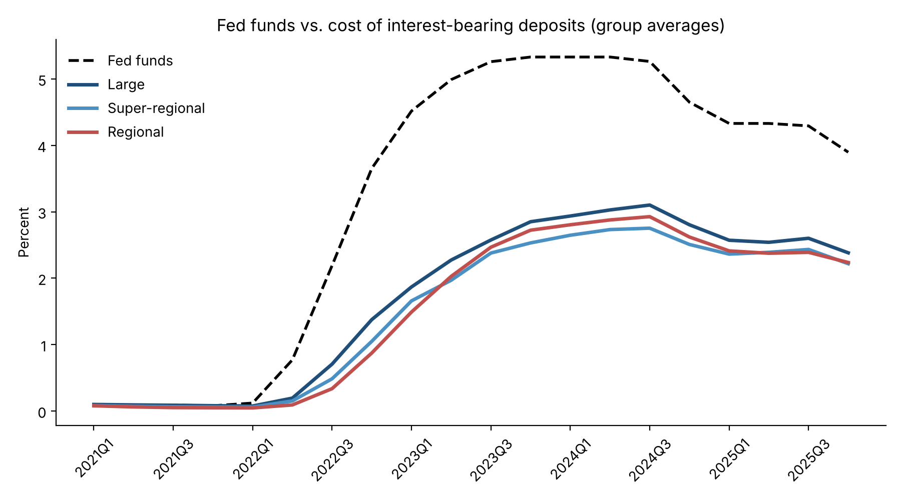
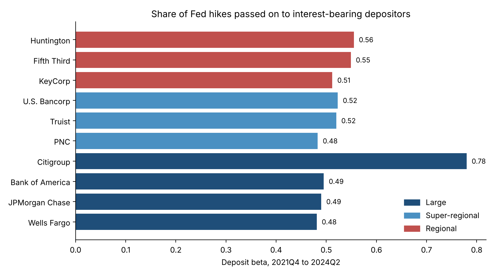
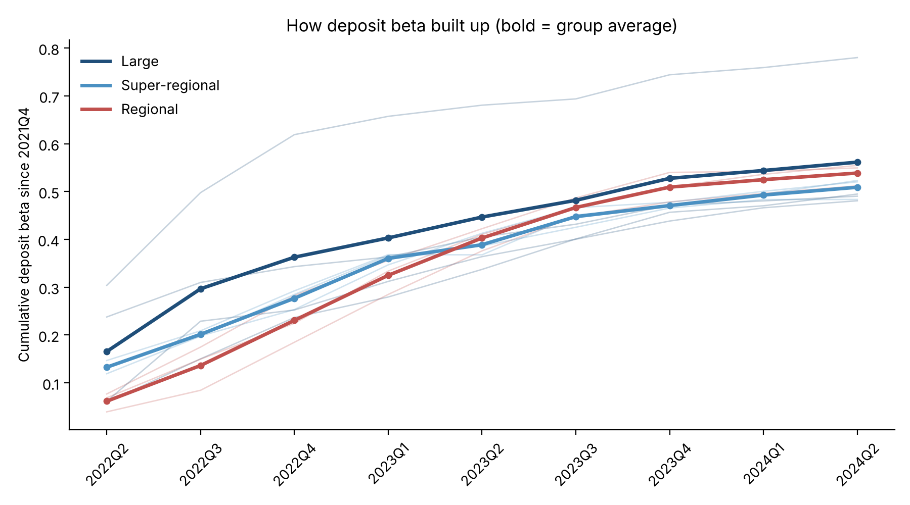
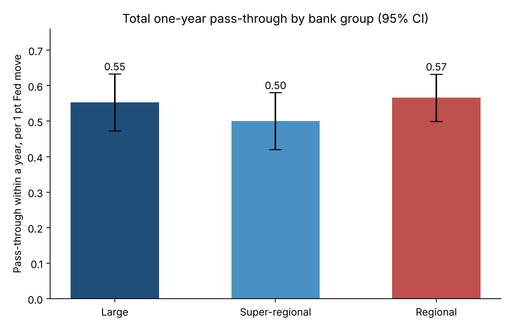

# Deposit Betas Through the 2022-2025 Rate Cycle

When the Fed raised rates from near zero to 5.33% in 2022 and 2023, how much of that increase did US banks pass on to depositors, and how fast? Did regional banks have to pay depositors more than the largest banks? And how much did deposit costs come back down once the Fed started cutting in September 2024?

**Deposit beta** = change in a bank's cost of interest-bearing deposits / change in the Fed funds rate. A beta of 0.40 means the bank paid depositors 0.40 points more for every 1 point the Fed raised. Asset-liability management (ALM) teams track it closely because it drives how net interest income responds to rate changes.

## Key findings

1. **About half of the Fed's hikes reached depositors.** Over the full hiking cycle (2021Q4 to 2024Q2), deposit betas ranged from 0.48 (Wells Fargo, PNC) to 0.56 (Huntington), with one outlier: Citigroup at 0.78.
2. **Regional banks ended up paying the most.** Excluding Citigroup, regional banks' average beta was 0.54, vs. 0.51 for super-regionals and 0.49 for JPMorgan, Bank of America and Wells Fargo.
3. **Regional banks started slow, then caught up after the March 2023 bank failures.** By the end of 2022 their beta was only 0.23, vs. 0.28 for the large banks excluding Citigroup. They overtook the large banks in 2023Q1 and kept pulling ahead through 2024.
4. **Deposit costs came down more slowly than they went up.** Easing-cycle betas (2024Q2 to 2025Q4) averaged 0.36 to 0.45 by group and were lower than the hiking-cycle beta for all 10 banks.
5. **Citigroup's 0.78 beta** is likely driven by its mix of US deposits, which leans toward corporate and wealth clients who move money quickly when rates rise.
6. **The regression confirms 0.50 to 0.57 of each Fed move passed through within a year**, with tight confidence intervals for all three groups.

See [`output/summary.md`](output/summary.md) for the full tables.






## Data

| Source | What | How |
| --- | --- | --- |
| FDIC BankFind API | Quarterly call report data, 2020Q4 to 2025Q4 | Downloaded by the script |
| FRED (St. Louis Fed) | Effective Fed funds rate, series FEDFUNDS | Downloaded by the script |

**Banks (FDIC certificate number):** JPMorgan Chase (628), Bank of America (3510), Wells Fargo (3511), Citigroup (7213) as Large; U.S. Bancorp (6548), PNC (6384), Truist (9846) as Super-regional; KeyCorp (17534), Fifth Third (6672), Huntington (6560) as Regional. Each is the holding company's main US bank subsidiary.

## Method

1. **Cost of interest-bearing deposits** for each bank and quarter = quarterly domestic deposit interest expense, annualized, divided by the average of start- and end-of-quarter interest-bearing domestic deposits. Foreign deposits are excluded because they are priced off other central banks' rates.
2. **Fed funds** is averaged over each quarter, since interest expense accrues over the whole quarter.
3. **Three betas per bank:**
   - Full hiking cycle: 2021Q4 to 2024Q2 (ends at the last quarter before the first cut, so it captures repricing that continued after the final hike)
   - By end of 2022: 2021Q4 to 2022Q4
   - Easing: 2024Q2 to 2025Q4
4. **Distributed-lag regression** for each bank group:

   `Δcost(t) = a_bank + b0·ΔFF(t) + b1·ΔFF(t-1) + b2·ΔFF(t-2) + b3·ΔFF(t-3) + e`

   b0 to b3 show how quickly pass-through happens; their sum is total pass-through after a year (reported with its standard error). Bank fixed effects; heteroskedasticity-robust (HC1) standard errors.

## Run it

```
pip install -r requirements.txt
python deposit_beta.py
```

Downloaded data is saved in `data/` so results are reproducible. Delete those files to pull fresh data.

## Limitations

- Call report data is for the bank subsidiary, not the holding company, so figures can differ slightly from earnings releases.
- Three or four banks per group is a small sample; group differences are indicative, not conclusive.
- The cost measure uses period-end balances, not daily averages.
- Mergers shift balances in a few quarters: Huntington and TCF (2021Q2), PNC and BBVA USA (2021Q4), U.S. Bancorp and MUFG Union Bank (2023Q2). None falls on a beta start or end quarter except PNC's 2021Q4, where its deposit cost was near zero either way.
- Back-to-back Fed moves make the individual lag coefficients highly correlated (about 0.8), so only their sum is reported as reliable.
